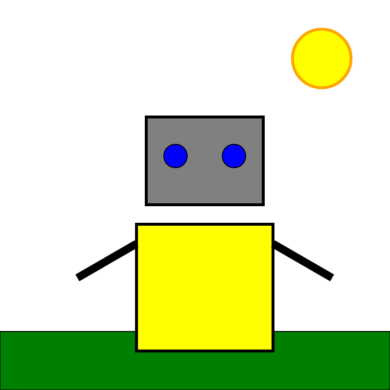

# Linguagem de desenho — Fase 2: da AST ao SVG

Laboratório de Programação Avançada II (Compiladores).
Verificação semântica e gerador de SVG para a linguagem de desenho. O caminho completo roda na página-base:
programa → tokens → AST → verificação semântica → SVG → desenho.

## Integrantes

| Nome completo | RA |
|---|---|
| Giulia Nogueira Lopes de Sá | 23024383 |
| Ruan Paulo de Sousa Soares | 23024986 |
| Rafael Ferreira | 23024975 |
| Yasmin Ribeiro | 23024985 |
| Marco Antonio de Oliveira Junior | 25028231 |
| Pedro Henrique Dangelo dos Reis | 23024777 |

## Entrega

| Arquivo | Conteúdo |
|---|---|
| [`docs/documento-semantica.pdf`](docs/documento-semantica.pdf) | Documento de semântica: mapeamento de nós para SVG, tabela de cores, verificações e decisões de projeto |
| [`semantica.js`](semantica.js) | Verificação semântica: `verificar(ast)` devolve os erros com a linha |
| [`gerador.js`](gerador.js) | Gerador de SVG: `gerarSVG(ast)` percorre a AST recursivamente |
| [`parser.js`](parser.js) | Parser da Fase 1, com o campo `linha` em cada nó da AST e o estilo em qualquer ordem |
| [`tokens.js`](tokens.js), [`lexer.js`](lexer.js) | Análise léxica (Fase 1) |
| [`svg.js`](svg.js), [`main.js`](main.js), [`index.html`](index.html) | Página-base do professor (sem alterações) |
| [`testes/`](testes/) | 8 programas de teste (5 válidos, 2 com erro semântico e o desenho final), cada um com seu `.svg` e imagem; [`casos-de-teste.md`](testes/casos-de-teste.md) descreve o resultado esperado |
| [`fase1/`](fase1/) | Entrega da Fase 1 (léxico, sintático, AST e especificação), preservada como estava |

## Como executar

**Página online:** https://giunogueirasa.github.io/programacao-avancada-2-linguagem-desenho/

Para rodar localmente: os arquivos usam módulos JavaScript (`type="module"`), que o navegador não carrega abrindo o `index.html` direto do disco. Use uma destas opções:

- abrir a pasta no VS Code e usar a extensão **Live Server**; ou
- rodar `python -m http.server` na pasta e acessar `http://localhost:8000`.

Escreva um programa na caixa da esquerda e clique em **Analisar**. A página mostra os tokens, as mensagens de cada fase e, se não houver erro, o SVG na caixa da direita, já desenhado. O botão **Baixar .svg** salva o arquivo `desenho.svg`.

## Erros que a página mostra

- **Léxico:** trecho que não forma nenhum token (por exemplo, `quadrado`).
- **Sintático:** linha, o que era esperado e o que foi encontrado.
- **Semântico:** linha e motivo. São três verificações: tela com largura ou altura zero, círculo com raio zero e retângulo com largura ou altura zero.

Em cada fase com erro, as seguintes não rodam, e nenhum SVG é gerado.

## Desenho final

[`testes/programas/desenho-final-robo.txt`](testes/programas/desenho-final-robo.txt) desenha um robô com sol e chão. Ele usa as três formas, grupos aninhados (o robô é um grupo, e os braços são grupos dentro dele) e os dois modificadores (`mover` e `girar`).

## Decisões de projeto

Estão no [documento de semântica](docs/documento-semantica.pdf). Em resumo:

- estilo ausente: traço preto, espessura 1 e sem preenchimento; cada forma escreve os três atributos;
- grupo sem modificadores vira `<g>` sem `transform`;
- vários modificadores viram um único `transform`, na ordem em que foram escritos;
- atributo de estilo repetido vale o último, e os atributos podem vir em qualquer ordem (ajuste no parser da Fase 1).
